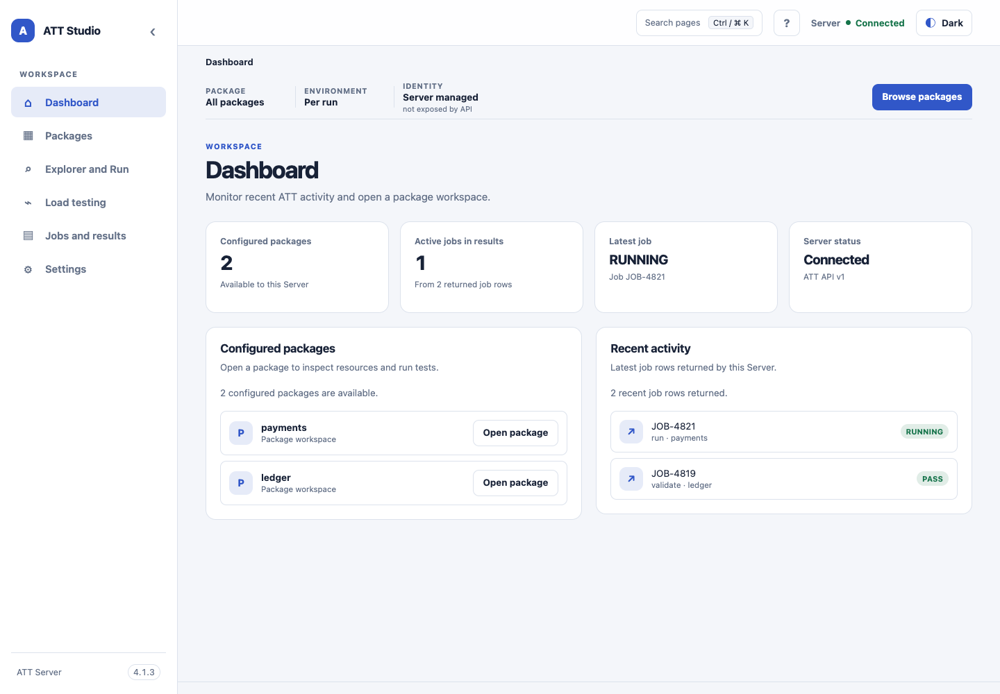

# ATT 4.6.0 — API and integration testing (release target)

**Release status: not published.** This documentation describes the 4.6.0 formal release target; no 4.6.0 release or tag exists. The 4.3.1 version identifies an earlier CLI code line and is not a verified GitHub Release.

The current default branch contains Native Case implementation for inline and Excel data, Studio editing and preview, implicit Suites, Native reports, and Default Package examples. That code is integrated here. Issue [#393](https://github.com/jxb8901/temp-driven-api-testing-tool/issues/393) is closed, which accepts Native RUN for that issue; closing it is not a published 4.6.0 release. Report acceptance ([#397](https://github.com/jxb8901/temp-driven-api-testing-tool/issues/397)) and Default Package adoption ([#413](https://github.com/jxb8901/temp-driven-api-testing-tool/issues/413)) remain open. Shared-editor deployment evidence is tracked separately in [#387](https://github.com/jxb8901/temp-driven-api-testing-tool/issues/387). Native LOAD Case targets ([#418](https://github.com/jxb8901/temp-driven-api-testing-tool/issues/418)), advanced Testdata and generators ([#419](https://github.com/jxb8901/temp-driven-api-testing-tool/issues/419)), and Debug interoperability ([#420](https://github.com/jxb8901/temp-driven-api-testing-tool/issues/420)) stay deferred.

ATT is a Package-oriented platform for functional API and integration testing and controlled Load testing. A Package groups Native Case Definitions (`testcase.yaml`), Flows, Actions, Tools, Testdata and other business resources behind one registered root. Shared Runtime Configuration and Environment profiles bind those resources to SIT, UAT or another environment.

ATT supports Local execution, an optional ATT Server control plane, a browser Studio, and a versioned REST API. The Engine’s primary functional path is Native Case → Flow → Actions/Resources. Debug adds diagnostic detail to a RUN. LOAD uses separate workload pacing and evidence controls. VALIDATE checks configuration, Package resources and dependencies without business execution. Older Stage/Template/Sidecar/Snapshot execution lives under [Legacy documentation](docs/legacy/README.md).



*Illustrative Studio UI-shell baseline with sample Package and Job data; the version badge belongs to that screenshot baseline.*

## Quick Start: Native Case (4.6.0 release target)

Primary happy path on the release-target stack; release and deployed acceptance remain pending:

```text
Package → Flow → testcase.yaml → Preview/Resolve → Select Case(s) → Validate → RUN
```

~~~sh
./att.sh validate --package
./att.sh --local -p default run native-case quick.start.single --resolved-case-id default
~~~

Open [Quick Start](docs/quick-start.md) for the offline Native fixtures (single / inline-multi / Excel) and Studio preview notes. The same guide is available in [繁體中文](docs/quick-start.zh.md). Migration decisions live in the [S12 matrix](docs/maintenance/native-case-default-package-migration-s12.md). Existing legacy Packages have a separate [Legacy documentation path](docs/legacy/README.md).

## What ATT provides

- Package isolation and reusable authoring with Native Test Case Definitions (`testcase.yaml`), Flows, Actions, Tools and Resources; earlier Package formats remain supported through the Legacy path.
- Functional RUN and separate LOAD execution, with read-only VALIDATE.
- Shared Runtime Configuration, Environment profiles, optional Package Manifest defaults and Package-owned Testdata.
- Local CLI, ATT Studio, REST/SSE integration and Server Jobs and Schedules.
- Bounded diagnostics, reports and evidence with secret protection.

## Documentation

- [Documentation map](docs/README.md): start pages for test authors, CLI users, load testers, Studio operators, Server administrators, integrators and contributors.
- [Concepts](docs/concepts/): Package, authoring, execution, configuration and Server lifecycle.
- [Guides](docs/guides/): task-oriented RUN, LOAD and validation procedures.
- [Current CLI Reference](docs/reference/cli.md) and [ATT Remote compatibility guide](docs/remote-client.md).
- [Proposed CLI vNext](docs/interfaces/cli/vnext-proposed.md) is a plan for a later release and is not part of the 4.6.0 target.
- [Generated Reference Manual](docs/reference.md) and [繁體中文 Reference](docs/reference.zh.md).
- [Server deployment](docs/operations/server-deployment.md), [Studio interfaces](docs/interfaces/studio/), and [Server API v1](docs/interfaces/server-api/).
- [Documentation architecture and inventory](docs/system-design/documentation-architecture.md); [history archive](docs/history/README.md).

## Build and documentation checks

Use a JDK and Maven to build the project. The source launcher runs prebuilt classes and does not compile code.

~~~sh
mvn clean verify
python3 -B tools/build_reference_manual.py --check
python3 -B tools/verify_documentation.py
./build.sh
~~~

The Server WAR requires Java 17 or later and external Tomcat 10.1+. The Local CLI, Engine, Worker, Remote client and Server API retain the published Java 8 baseline. See the [multi-module build guide](docs/system-design/multi-module-build.md) for maintainer details.
