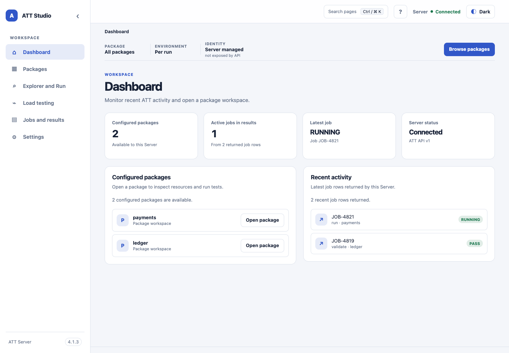

<!-- att-doc-status: current release=4.2.8 -->

# ATT Studio 介面

ATT Studio 是瀏覽器介面，用於瀏覽已註冊 Package 及管理 Server lifecycle。

*畫面為使用範例 Package 及 Job 資料的 UI shell 基線截圖；版本標籤屬於該截圖基線。*

- [導覽與 Package 選擇](navigation.zh.md)
- [Explorer、Resource 檢視及功能執行](explorer-run.zh.md)
- [Load Testing](load-testing.zh.md)
- [Jobs 與結果](jobs-and-results.zh.md)
- [Schedules](schedules.zh.md)
- [管理與本機帳戶](administration.zh.md)

Studio 使用公開的 same-origin REST 及 SSE contract。Server 負責權限、schema validation、draft、revision 及 execution。
