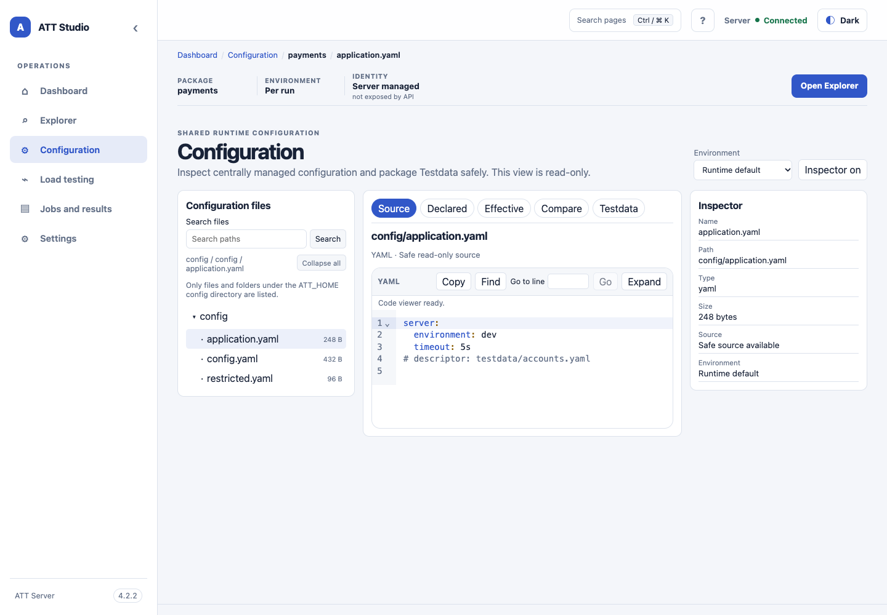

<!-- att-doc-status: current release=4.2.7 -->

# Studio administration

*Static UI-shell baseline capture with sample configuration data; the version badge belongs to the screenshot baseline.*

## Account management

In local mode, the current-user menu offers **Change password** to every signed-in local user. The form requires the current password, new password, and confirmation. A successful change revokes the current session and redirects to the login page with a success message. Password inputs stay in the active form only; the UI does not write them to local storage, session storage, URLs, or application logs.

Local `ADMIN` users can open **Settings → User Management** to search and sort the safe account list by login ID, display name, role, and status. They can create `ADMIN` or `USER` accounts, enable or disable an account, and reset a password. Create and password forms require matching confirmation and follow the Server's 12–1024 character password policy. Existing passwords are never displayed. Disabling a user or resetting a password requires confirmation and revokes that user's sessions. The Server prevents disabling the last active `ADMIN`, including concurrent disable requests. If every administrator is unable to sign in, use the offline recovery procedure in the [Server deployment guide](../../operations/security.md#recover-a-locked-out-local-administrator); recovery only updates an existing `ADMIN` and never reopens bootstrap.

The account list and controls are available only to authenticated local `ADMIN` users. Other local users see no account data or management controls. In container mode, Settings explains that Tomcat or the configured SSO provider manages accounts; ATT does not show external accounts as if it owned them. Settings can use English or Traditional Chinese, follow the browser language, or save a language choice in this browser. The UI keeps the Server authoritative for access checks and password policy.

## Monitoring

**Monitoring** provides a read-only `att-monitoring/v1` snapshot for active local `USER` and `ADMIN` accounts and authorized container users or administrators. It uses the allowlisted `/api/v1/monitoring` endpoint, separate from the administrator-only raw `/api/v1/metrics` endpoint. Snapshots cover process and JVM use, worker admission, HTTP and SSE activity, journal compaction, storage, inspection and execution pools, schedules, and aggregate Job states. The dashboard marks unsupported measurements as unavailable, labels cumulative counts, and derives interval rates and compaction-failure changes from bounded session history. Active-job compaction failures remain available as an active aggregate; `compactionFailuresSinceStart` is cumulative for the current Server runtime so interval alerts remain monotonic when Jobs leave memory. It does not collect process RSS or SSE reconnect/error counts; archive bytes remain unavailable unless aggregate sampling is implemented. Per-Job journal details use only active or already-cached data and provide a link to the authorized Events view when metrics are unavailable. The response does not expose secrets, filesystem paths, raw events, or per-Job payloads.

The page refreshes every 15 seconds by default and offers 5, 15, 30, or 60 seconds. Polling pauses when the browser tab is hidden, requests do not overlap, and history is held only in the current page session with a 96-snapshot bound. The page shows freshness and failures and provides threshold and recent-delta alerts. The per-Job journal panel returns a bounded journal summary only when the caller is authorized to view that Job; system administrators can inspect any existing Job's journal summary.
