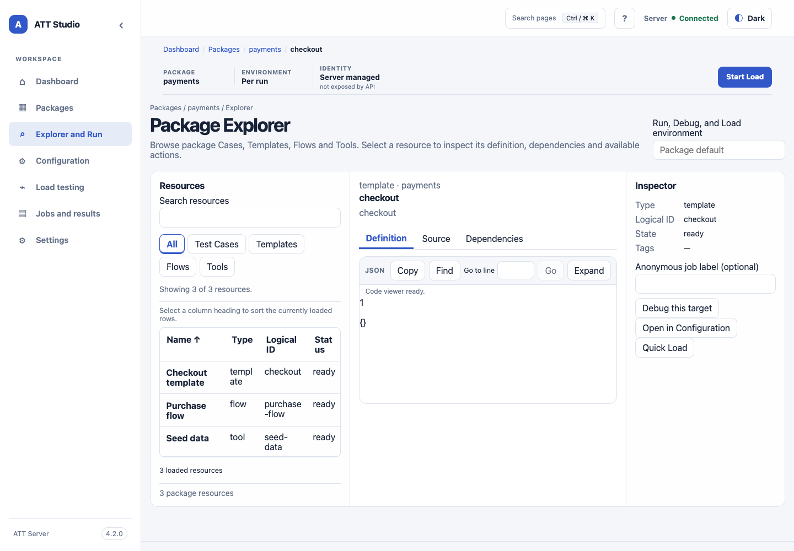

<!-- att-doc-status: current release=4.3.1 -->

# Explorer and functional execution

*Static UI-shell baseline capture with sample Package and resource data; the version badge belongs to the screenshot baseline.*

The Package Resource Explorer lists configured Cases, Templates, Flows, and Tools by package-scoped logical resource ID. It supports type and text filters, stable server-side sorting across all matching resources before pagination, encrypted cursors, resource details, and safe references. Under the default `safe-package-files` policy, eligible package-local Tool scripts and safe `&{...}` targets can be opened without per-file entries when reached from an authorized source; Template and Flow YAML remains a sanitized projection. `allowlist-only` uses exact package-relative `server.inspection.safeTextSources` entries. External scripts require an exact canonical per-package allowlist under a configured external root, and their filesystem paths are hidden. Case details show identity and stage/template metadata but hide workbook business values. Reverse references include at most 100 inline entries plus an exact count and `referencedByHasMore` flag. The Explorer does not browse arbitrary files or execute Tools. Authenticated Package owners with source-editing access can use the separate Change Set authoring workspace; edits remain drafts until the Server validates, reviews, and publishes them. If a package changes during pagination, or the sort/filter query changes, the Server rejects the stale cursor and the UI can refresh the list.

Use **Validate Package** from the Resources toolbar to inspect the opened Package, or choose **Validate Case**, **Validate Suite**, or **Validate** from selected resource actions. The inline result uses the opened Package and Environment and submits a durable record through `POST /api/v1/validations`. A selected resource action checks only that target; it does not scan the full Package. Helper text explains that validation does not run tests or create a Job. Navigating away or closing the result does not cancel Server work. See [Read-only validation](validation.md).

Debug is available from a selected Template, Flow, or Tool detail. The form loads safe defaults from the target's optional `debug.yaml`; if it is missing, the Server supplies valid empty `att-debug/v1.2` defaults. Package-authored values are hidden by default. A `$attDebugKeepDefault` marker retains a hidden value when left unchanged; replace it with an explicit value to override it. Edit nested values as JSON objects, reset to the loaded defaults, validate, and review the redacted YAML preview before starting Debug. All targets use `inputs`; Template and Flow also use `vars`, while Tool uses `arguments` and does not accept `vars`. The Server binds each in-memory draft to the authenticated Principal and current package revision. Drafts expire after 10 minutes and are invalidated by a Server restart. Editing or submission never writes a package file. The original path-based Debug API remains available to compatible clients.

## Package Explorer and Debug

The React Explorer presents package resources, the selected definition, and resource actions in a three-pane workspace. Select a Case, Template, Flow, or Tool to open its details. The resource-type filters form one keyboard-operable radio group, and the Resources toolbar keeps **Refresh resources**, **Validate Package**, **Run Test Cases…**, and **Testdata** together. **Run Test Cases…** opens the existing Run editor with all cases selected; it does not submit a Job. The Run editor also offers **Native Suite**: enter one or more Test Case Definition IDs, then select all Cases, explicit Qualified Case IDs, or Cases matching tags. Optional included and excluded tags further filter the selection; replay preserves tag selectors returned in the saved definition. Validation creates an `att-execution/v2` draft; the Server resolves the selection and freezes the accepted IDs and Definition revisions before submission. Native Suite `rerun-failed` remains unavailable until the retry source Job/run and selected failed IDs can be retained as explicit lineage. Testdata remains a view, not a resource type filter. The `#/packages/{packageId}/resources/{type}/{resourceId}` hash route restores the selected resource on reload and supports browser navigation. The Definition, Source, and Dependencies tabs support keyboard navigation with the arrow keys, Home, and End.

Package Testdata is a read-only Explorer view at `#/packages/{packageId}/testdata`. It uses that route's Package and Environment, and an optional `descriptor` query value restores a selected descriptor. Descriptor records stay bounded to 50 rows per request; generated records remain withheld until **Preview first 50 generated records** is selected. Testdata is not an executable resource and is absent from the Run and Quick LOAD target lists. Shared Configuration contains only global Source, Declared, Effective, and Compare views; Package Testdata metadata and origins remain in Package Configuration.

In an authorized Package source workspace, **Import Package ZIP** stages Package-root-relative files into one private Change Set. Choose a ZIP whose entries use paths such as `templates/`, `files/`, or `load/sut-metrics/sources/`; include `package.yaml` when changing the Package's explicit inventory, and do not include a wrapper directory. Imports are bounded to 16 MiB compressed, 32 entries, 4 MiB per file, and 8 MiB expanded total, and unsafe paths, special files, duplicate paths, and excessive expansion are rejected. Import does not write published files. Validate the candidate, review the changed-file diff, and publish only after the Server accepts it. The global Runtime Config owns shared SUT Metrics Data Source connections through `sutMetrics.dataSources`; `package.yaml` inventories each Package's Metric Sources, Groups, and Profiles. Package ZIP imports target only the selected Package source tree and cannot edit the global Runtime Config.

The Source tab loads only the Server's safe source projection. For an eligible Action `&{path}` reference, the source panel offers **View referenced file** and preserves the authored expression. This follows the Server-issued opaque reference and rechecks the Package, origin, reachability, and safe-source policy. The resulting Package-relative source view is read-only, bounded and redacted, with safe nested-reference navigation and a return to its calling source. It never evaluates `${...}` or `#{...}` expressions. It displays at most the first 200,000 characters and 12,000 lines, virtualizes visible lines, and renders source as text. Refresh it after a package change. **Copy displayed source** copies only the text shown within those limits. An empty or unavailable projection is reported explicitly; authentication and permission errors do not include raw response details.

Debug and case execution are available from the resource inspector. Sidecar-provided scalar leaves have typed controls for text, numbers, booleans, and null. Nested values and the complete business input remain editable in **Advanced JSON**. Correct invalid JSON or scalar values before validating. **Reset defaults** restores the values loaded from the sidecar. If the Server marks a sidecar value redacted, the form shows a keep-default marker; it does not reveal the hidden value. Leave the marker selected to preserve the package value, or choose a type and enter an explicit override. Validate and inspect the safe preview before starting Debug. The Server remains authoritative for validation and access checks.

Changing package, resource, or environment while Debug edits are unsaved asks before discarding them. The same guard covers hash-route navigation and browser back/forward changes. The optional job label is sent with the execution request as its Principal label; it does not replace Tomcat authentication. If the session expires, sign in again and retry. Anonymous deployments can still use the label when the Server permits the request.
