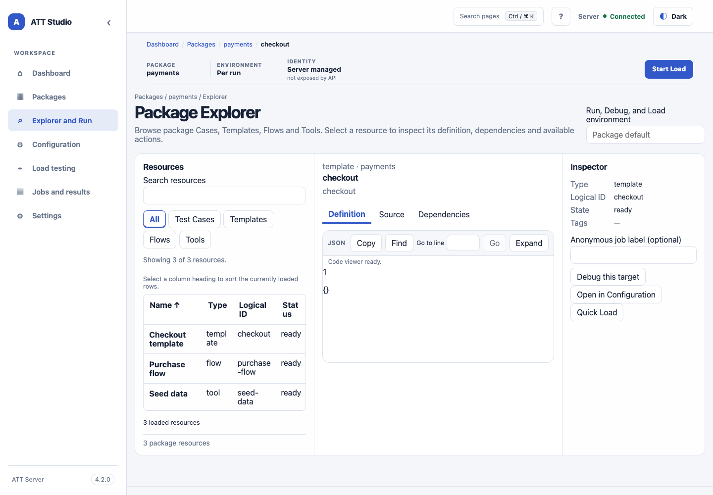

<!-- att-doc-status: current release=4.3.1 -->

# Explorer 與 functional execution

*Explorer 靜態 UI shell 基線截圖，使用示例資料；圖中版本標籤屬於截圖基線。*

Package Resource Explorer 會按 package-scoped 邏輯資源 ID 列出已設定的 Case、Template、Flow 及 Tool，並支援類型與文字篩選、跨所有符合項目排序後再分頁、加密 cursor、資源詳細資料及安全關聯。在預設 `safe-package-files` policy 下，已授權 source 所連結的合資格 package-local Tool scripts 及安全 `&{...}` targets 無須逐檔設定即可開啟；Template/Flow YAML 仍以淨化投影回傳。`allowlist-only` 使用完全相同的 package-relative `server.inspection.safeTextSources` 路徑。External scripts 必須位於已設定的 external root 並列入每 package canonical 精確 allowlist，回應會隱藏 filesystem path。Case 詳細資料會顯示身份及 Stage/Template 中繼資料，並隱藏 workbook 業務值。反向關聯最多內嵌 100 筆，並同時回傳準確數量及 `referencedByHasMore`。Explorer 不會瀏覽任意檔案或執行 Tool。具 source-editing 權限的已驗證 Package owner 可使用獨立 Change Set authoring workspace；修改會先保留為 draft，直至 Server 完成 validation、review 及 publication。若分頁期間 package 或排序／篩選條件有變更，Server 會拒絕過期 cursor，UI 可重新整理清單。

使用 Resources 工具列的 **驗證套件**檢查已開啟的 Package，或從所選資源 action 選擇 **驗證案例**、**驗證套件集**或 **驗證**。Inline result 使用已開啟的 Package 及 Environment，並透過 `POST /api/v1/validations` 提交持久 record。所選資源 action 只檢查該 target，不會掃描整個 Package。提示文字會說明 validation 不會執行測試或建立 Job。離開頁面或關閉結果不會取消 Server 工作。詳見[唯讀 validation](validation.zh.md)。

Debug 只能從已選取的 Template、Flow 或 Tool 詳細資料開啟。表單會載入該目標選填 `debug.yaml` 的安全預設值；若檔案不存在，Server 會提供有效的空白 `att-debug/v1.2` 預設值。Package 撰寫的值預設會隱藏。保留 `$attDebugKeepDefault` 標記即可沿用隱藏值；若要覆寫，請改成明確值。可以用 JSON object 編輯巢狀值、還原已載入的預設值、驗證，並在開始 Debug 前檢視已遮蔽的 YAML 預覽。所有目標都使用 `inputs`；Template 與 Flow 亦使用 `vars`，Tool 則使用 `arguments` 並不接受 `vars`。Server 會將記憶體中的 draft 綁定至已驗證 Principal 及目前 package revision。Draft 於 10 分鐘後過期，Server 重啟後失效。編輯或提交都不會寫入 package 檔案。現有以路徑提交的 Debug API 仍供相容用戶端使用。

## Package Explorer 與 Debug

React Explorer 以三欄工作區呈現套件資源、所選定義及資源操作。選擇 Case、Template、Flow 或 Tool 即可開啟詳細資料。資源類型篩選以單一可用鍵盤操作的 radio group 呈現；Resources 工具列集中 **Refresh resources**、**驗證套件**、**執行測試案例…**及 **Testdata**。**執行測試案例…**會開啟既有 Run editor 並預選全部案例，不會提交 Job。Run editor 亦提供 **Native Suite**：可輸入一個或多個 Test Case Definition ID，再選擇全部 Case、指定 Qualified Case ID，或按 tags 選取 Case。可用 Include Tags 和 Exclude Tags 進一步篩選；重播時會保留保存定義傳回的 tag selector。Validation 會建立 `att-execution/v2` draft；Server 解析選取項目，並在提交前凍結接受的 ID 和 Definition revision。Native Suite 的 `rerun-failed` 尚不可用；需先明確保留重試來源 Job/run 及失敗 Case ID，形成可追蹤的 retry lineage。Testdata 仍是檢視，不是資源類型篩選。`#/packages/{packageId}/resources/{type}/{resourceId}` hash route 會在重新載入時還原所選資源，並支援瀏覽器導覽。Definition、Source 及 Dependencies 分頁可使用方向鍵、Home 及 End 鍵盤操作。

Package Testdata 是唯讀 Explorer 檢視，route 為 `#/packages/{packageId}/testdata`。它使用該 route 的 Package 與 Environment，並可透過選用的 `descriptor` query 還原所選 descriptor。每次請求最多讀取 50 筆 record；Generated records 會在使用者選擇 **Preview first 50 generated records** 前保持隱藏。Testdata 不是可執行的 resource，不會出現在 Run 或 Quick LOAD target 清單。Shared Configuration 只包含全域 Source、Declared、Effective 及 Compare 檢視；Package Testdata metadata 與 origin 仍保留於 Package Configuration。

在已授權的 Package source workspace 中，**Import Package ZIP** 會把相對於 Package root 的檔案暫存至單一私人 Change Set。ZIP entry 可使用 `templates/`、`files/` 或 `load/sut-metrics/sources/` 等路徑；更改 Package 的明確 inventory 時亦要包含 `package.yaml`，不要額外包一層目錄。匯入上限為壓縮後 16 MiB、32 個 entry、每檔 4 MiB、解壓後總計 8 MiB；不安全路徑、特殊檔案、重複路徑及過度膨脹的 archive 會被拒絕。匯入不會寫入已發佈檔案。請先驗證候選內容並檢視 changed-file diff，待 Server 接受後才發佈。全域 Runtime Config 透過 `sutMetrics.dataSources` 管理共用 SUT Metrics Data Source connections；`package.yaml` inventory 該 Package 擁有的 Metric Sources、Groups 及 Profiles。Package ZIP 只會修改所選 Package 的 source tree，不會編輯全域 Runtime Config。

Source 分頁只載入 Server 提供的安全 source projection。符合條件的 Action `&{path}` reference 會在 source panel 顯示 **View referenced file**，並保留原始 expression。導覽會使用 Server 簽發的 opaque reference，並重新檢查 Package、origin、可達性及 safe-source policy。Package-relative source 檢視唯讀、設有大小上限並經過遮蔽；只會提供安全的巢狀 reference 導覽，並可返回呼叫端 source。檢視時不會評估 `${...}` 或 `#{...}` expression。畫面最多顯示前 200,000 個字元及 12,000 行，並只渲染視窗內的行；source 內容會以純文字呈現。Package 更新後可重新整理。**Copy displayed source** 只會複製上述上限內已顯示的文字。空白或不可用的 projection 會明確顯示；驗證及權限錯誤不會包含原始回應細節。

可從資源 Inspector 執行 Debug 或 Case。Sidecar 提供的 scalar 欄位會使用文字、數字、布林值及 null 等型別控制項。巢狀值及完整 business input 可在 **Advanced JSON** 編輯。提交驗證前，請修正無效 JSON 或 scalar 值。**Reset defaults** 會還原從 sidecar 載入的值。若 Server 將 sidecar 值標示為 redacted，表單會顯示 keep-default 標記，不會揭露隱藏值。保留標記即可沿用 package 值；如需覆寫，請選擇型別並輸入明確值。開始 Debug 前請先驗證並檢視安全預覽。Server 仍是驗證及存取檢查的權威來源。

當 Debug 編輯尚未儲存時，切換 package、resource 或 environment 會先詢問是否捨棄變更。同一保護也涵蓋 hash route 及瀏覽器上一頁／下一頁。選填 job label 會隨執行請求作為 Principal label 傳送；它不能取代 Tomcat 驗證。若 session 過期，請重新登入後重試。在 Server 允許請求時，匿名部署亦可使用此 label。
