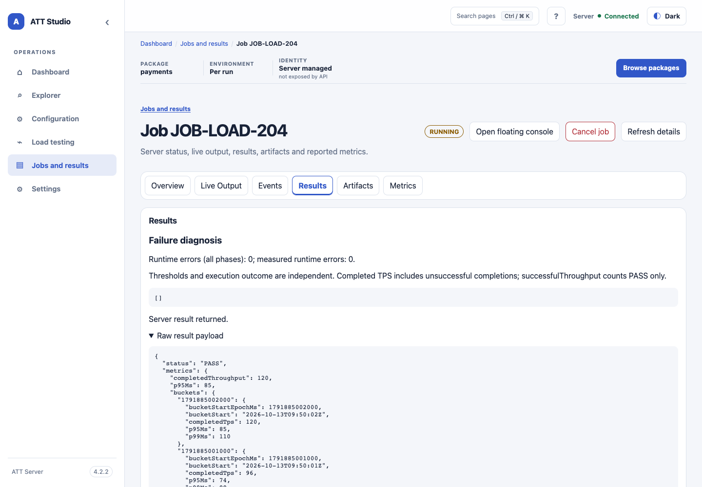
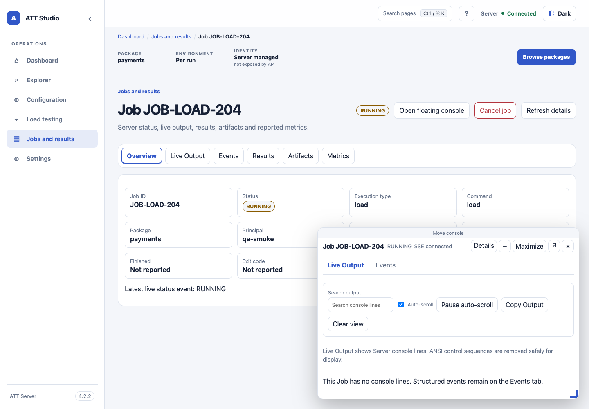

<!-- att-doc-status: current release=4.2.8 -->

# Jobs 與 results

*Job 結果示意畫面，使用示例執行資料。*

*浮動主控台靜態 UI shell 基線截圖，使用示例 Job 資料；圖中版本標籤屬於截圖基線。*

## Job workspace

### 分離及還原 Job 主控台

在 **Live Output**、**Events** 或 Job 詳情標題選擇 **Open floating console**。這個非 modal 主控台會留在 Studio shell 上方；切換 Explorer、Configuration、Load testing、Jobs 或 Settings 時不會卸載。它顯示 Job ID、RUN／DEBUG／LOAD 類型、狀態、SSE 狀態、可搜尋的 Live Output、結構化 Events、暫停／繼續、複製、最大化／還原及關閉控制項。桌面版可拖曳 **Move console**，或用方向鍵移動；可拖曳角落控制項，或用方向鍵調整大小。面板會限制在 viewport 內；較小螢幕會改為全螢幕 sheet。

每個 Studio 分頁只有一個 floating console。開啟另一個 Job 前會要求確認 **Switch Job**。**Minimize** 會保留底部 console chip 及一條有界的該瀏覽器分頁 SSE 訂閱，使狀態和新事件保持更新，但不會渲染隱藏的事件列；所選 view、搜尋、篩選及捲動偏好會保留在 session 記憶體。**Close** 會釋放該訂閱。以上控制項都不會取消或停止 Job。

**Open full Job Details in a new tab** 開啟 `#/jobs/{encodedJobId}?standalone=1&tab=live`（或 `events`），包括 Overview、Live Output、Events、Results、Artifacts、Metrics。切換 tab 更新 URL 並固定同一 Job。舊 `#/jobs/{jobId}/console?view=live|events` 書籤使用完整 Details adapter。同源 `target="_blank" rel="noopener noreferrer"` 連結支援 `/att/ui/`、重新整理、Back/Forward。每個分頁內共用單一 Job stream；floating/docked/minimized console 維持原有行為。未授權或缺少的 Job 顯示安全 unavailable／登入訊息。

瀏覽器會立即把事件寫入最多 500 筆的有界 buffer，並以固定 100 ms 週期發布一般顯示 snapshot。Document 隱藏時會暫停發布顯示 snapshot，重新顯示時再發布當時的有界 snapshot。終端 `result` 事件、終端 `status` 事件、取消請求狀態及連線錯誤狀態轉換會立即發布。最後一個 consumer 關閉後，timer 及原生 `EventSource` 都會釋放。

Events 清單只渲染捲動位置附近的列（並以 spacer 保持捲軸及清單位置正確），事件 payload 在展開前保持收合，搜尋則涵蓋完整的 500 筆視窗，而非只搜尋已渲染列。

LOAD Overview、Results 及基本 Metrics 使用有界的 `att-load-terminal-result/v1` projection，會即時顯示執行結果、performance verdict、aggregate 計數及主要 runtime／preparation／validation 原因。Overview 讀取精簡的 `/jobs/{jobId}/artifacts/status` summary，不會列舉 artifact index 或下載報告內容。只有 publication 狀態為 PENDING 或 ARCHIVING 時才會輪詢；切換 tab 或隱藏頁面時會停止。Server 確認 archive summary 前，result 提供的 report path 會標示為未核實；只有已核實的 approved path 才會顯示報告連結。Overview 會分開顯示 archive 狀態及 Job 結果，以及 approved file 數、omitted 數及安全的 omission 類別；較舊 archive 格式沒有類別資料時，會說明原因在該版本中不可用。Aggregate 與 workload threshold 數量會分開顯示；execution status 與 performance verdict 亦互相獨立。

只有開啟 Results 或 Metrics 後，系統才透過授權 artifact index 核實 archive 狀態。開啟 Results 後才會載入授權 `load-summary.json` preview，顯示有界 evidence records、workload summaries，以及 workload sidecar 連結。開啟 Metrics 後才會透過授權 artifact text route 載入 `load-summary.json` 及其引用的 metric-series sidecar；archive 準備完成後才渲染詳細表格及 charts。Archived detailed report 使用 `att-load-summary/v1.3`，大型 series 存放於 `details/v1/` 的版本化相對路徑檔案。只有開啟 Artifacts 分頁才會載入完整 artifact 清單。詳細報告已載入時，charts 會使用回傳的 bucket（最多 4,096 個）；無障礙 bucket 表格每頁顯示 100 列，提供 Previous、Next 及 `Showing rows` 狀態。Bucket coverage 會指出 4,096 筆的一秒 rolling window，以及獨立的 `LoadWindowMetrics` bin 寬度與涵蓋範圍。隔離的報告預覽保留嚴格 iframe sandbox，只允許經審核且 hash 相符的報告 script；報告連結由已驗證身份的 parent UI 開啟。

Scheduler 已回傳 LOAD result，但 resource cleanup 失敗時，ATT 會保留已完成 metrics，並連同有界的 `TEARDOWN` diagnostic 發布報告。若 execution 已有失敗，cleanup 會列為次要問題。Cleanup 失敗會令 execution outcome 變成 ERROR，但 performance verdict 獨立保留；取消工作時 cleanup 失敗也會回報 ERROR 並保留 partial metrics。沒有 scheduler result 時，ATT 不會發布報告。

Server Journal Event ID 是 append order 的排序鍵；每個 Job 的 ID 在 Server 重啟、journal trimming 及 compaction 前後都保持單調遞增。UI 會按 Server append order 顯示事件，不會按 timestamp 重新排序。數字 ID 如不大於最後顯示的 ID，會視為 duplicate 或 stale out-of-order replay 而忽略，計入相應數量，且不會重新排序插入清單。向前出現 gap 是合法情況，只會計入診斷。非數字 ID 使用有界的 recent-ID index 去重。原生 `EventSource` 使用 `Last-Event-ID` 重新連線；重疊 replay 即使已離開可見 window，或在 **Clear view** 後到達，也不會再次出現。任何計數不為零時，非即時更新的 **Stream diagnostics** 訊息會顯示已忽略的 duplicate、out-of-order replay 及 ID gap 數量。

這些限制屬於不同層次。瀏覽器只顯示最近 500 筆已接受事件，不代表保留完整 Job 歷史。Server journal 決定可 replay 的範圍，較早 journal 歷史已截斷時會明確報告。#265 追蹤的 per-entry 限制會在發布前或期間縮短單一文字或 payload 欄位；瀏覽器不會重建或重新格式化這些 protocol 資料。

### Jobs 篩選與重播審閱

Jobs 的精簡工具列保留 Principal、Package、Type、Status 及 Target 搜尋。**More filters** 可展開 Created from/to、Deletion state 和 Pin state；收合後仍顯示已啟用的條件。Target 搜尋會在 Server 分頁前比對完整保留的 canonical target／Case ID，包括前 32 筆預覽之外的項目。沒有保留 Target metadata 的歷史 Job 仍可用 Job ID 搜尋。升級後，歷史 Target 索引會以背景批次繼續建立。未輸入搜尋條件時仍可瀏覽 Jobs；索引完成前，Target or Job ID 子字串搜尋會傳回可重試的 503（`ATT-SERVER-TARGET-SEARCH-PENDING`），不會顯示不完整結果。請以 **Refresh jobs** 重試。若要精確查詢，輸入 `job:` 加完整 Job ID（例如 `job:J0123456789ABCDEF`，區分大小寫）；此主鍵查詢在索引期間仍可使用，並保留其他篩選、筆數與分頁規則。無法解析的歷史 snapshot／identity 會逐筆隔離，以安全的 fallback 或空 Target 集合標記為已處理，並記錄不含私人 metadata 的 audit，不會永久阻擋索引。Group by Target 固定顯示 Target A–Z，群組內的 Jobs 按最新優先排列；返回 Recent Jobs 時恢復其選定的排序。

在 Jobs List、Job Details 或 LOAD History 選擇 **Rerun with same settings**，會開啟 review，提供預設的 **Use current Package** 及 **Require original revision (strict)**。Current mode 沿用舊 Job 的安全參數，但依目前 Package 及 configuration 驗證。Strict mode 在 revision 改變時阻止執行，並提供 **Review with current Package**。Schedule package-change policy 不控制手動 Rerun。

**Configure & Rerun** 會建立短期獲授權的 Server draft，並開啟預填支援安全欄位的標準 RUN／LOAD editor。URL 只含不透明 `draftRef`；定義透過授權且使用 `private, no-store` 的 request 載入。修改後按 **Validate → Review changes → Run**，檢查前後定義、目前 revision 及 LOAD timing／rate 細節。Back／Cancel 不修改 Job、報告、Schedule 或 package source。**Schedule / Reschedule…** 維持獨立，提供新增 Schedule 或開啟獲授權的來源 Schedule；不會啟動 Job。
