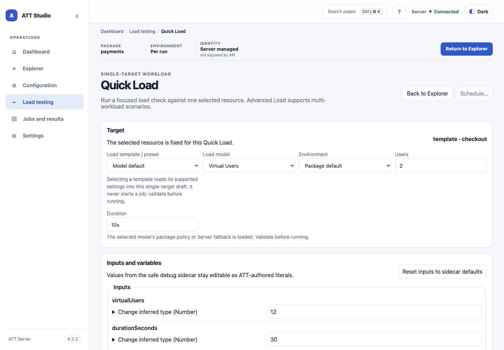
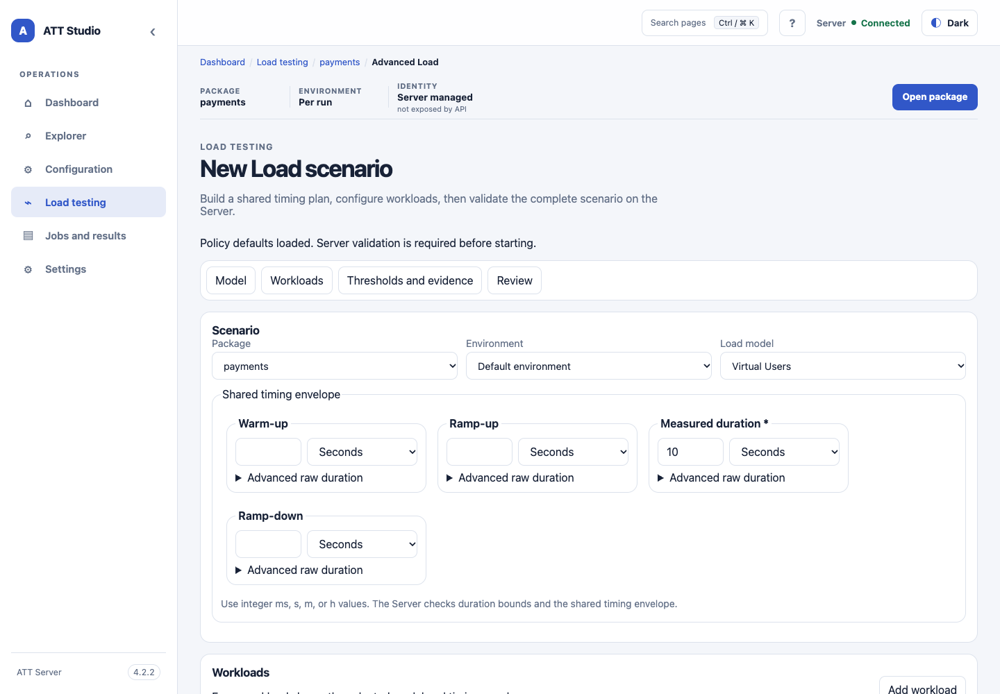

<!-- att-doc-status: current release=4.2.4 -->

# Studio Load testing

*Illustrative Quick Load form with sample settings.*

*Static UI-shell baseline capture with sample workloads; the version badge belongs to the screenshot baseline.*

Browser-created Quick and Advanced Load are disabled by default. A Server administrator must set `server.inlineLoad.enabled: true` and configure server-owned workload, target, user, rate, concurrency, and duration caps before those forms can create drafts. The UI reads `inlineLoadEnabled` from `/api/v1/version` and disables the Advanced Load entry and hides Quick Load when the feature is off; direct navigation displays the disabled state. A disabled endpoint returns `403 ATT-SERVER-INLINE-LOAD-DISABLED`; an over-limit draft returns `400 ATT-SERVER-INLINE-LOAD-LIMIT` with a summary naming the exceeded setting. This switch does not disable existing path-based Load clients.

Quick Load is a first-level route for one selected Template, Flow, or Tool. Its bounded template picker includes compatible policy-only YAML files from the package `load/` directory, including `load/load.visualuser.yaml` and `load/load.arrivalrate.yaml` when compatible, plus the bundled **Quick smoke** preset for Virtual Users. Selecting a template loads its supported settings; when no compatible package template is selected, the Server supplies the model-specific defaults or a bundled 10-second low-intensity fallback. Preset and model changes update the unsent scenario; the target remains fixed, and Debug-local Testdata imports are never promoted implicitly. Advanced Settings retain thresholds, evidence, execution options, Testdata paths, and a complete scenario preview. Validate the single-target scenario and confirm before submitting traffic. The Server binds the draft to the authenticated Principal and current package revision and submits the same immutable scenario it validated. Schedule carries that validated draft into an immutable inline Load snapshot, so the target, environment, inputs, pacing, thresholds, and evidence do not need to be re-entered.

Advanced Load is available from each package on the home page. Choose `virtualUsers` or `arrivalRate` before adding workloads; the selected model applies to every workload. Set a shared timing envelope, optional seed, package-relative Testdata imports, execution defaults, aggregate thresholds, and evidence policy. Add, duplicate, reorder, or remove workloads. Each workload has its own intensity, target, Testdata policy, and thresholds. A workload uses one Template, Flow, or Tool target, or a weighted target mix for Virtual Users. Arrival Rate workloads use one target each. Target sidecar defaults contain only safe business fields; Debug `case`, `stage`, and local Testdata are not copied. Validate the full scenario, review the safe YAML, then confirm before the Server submits its immutable draft through the normal Load scheduler. Copy and export are available only when the preview is not redacted.

Schedules is available in the React console at `#/schedules` when `/api/v1/version` reports `loadSchedulingEnabled: true` and the caller has operational access. Every active local `USER` or authenticated container principal in `server.authorization.userRole` can manage the shared schedules; `ADMIN` accounts receive system and account administration only. Schedule creator identity is retained for audit and display, not as an access boundary. Create schedules from a validated Quick or Advanced Load draft, or use an existing package-relative Load scenario. Draft-based schedules retain the Server-normalized immutable scenario snapshot; their API view exposes `inlineSnapshot` without returning the scenario contents. The Server revalidates the saved snapshot and package revision before each occurrence. The page supports optional descriptions and tags, next-run previews in the selected IANA timezone, and daily, weekly, or five-field cron recurrence. Preview calculates occurrence times only; saving validates the complete scenario and target closure through the inspection Worker. Switching recurrence replaces the stored trigger, while editing only metadata keeps that trigger and its Server-confirmed next run, so a consumed one-time schedule can still be renamed or re-described. A save-validation error shows its code and available summary, field, source location, package, environment, target, and suggestion, plus the request ID. Use **Review field** to focus the matching control or open the saved snapshot. Host-local absolute paths are masked. New schedules remain paused unless you select **Enable after saving**. Run Now and delete require confirmation. Occurrence history explains skips and submission failures and links submitted runs to the normal job page, results, events, and artifacts. Schedule state and history survive Server restarts. Editing or deleting a schedule does not cancel an accepted job.

From Quick or Advanced Load, **Schedule…** opens the schedule form over the current editor and shows the safe validated preview. Cancel returns to that same draft. The Server rejects an inline snapshot containing credentials or other classified sensitive values before saving the schedule; keep such values in package-managed configuration.

The shared React shell follows the operating system's light or dark preference until you choose a theme; your choice is saved in browser storage. Press `/` or `Ctrl K`/`⌘ K` to search pages, `?` to open the shortcut list, and `Esc` to close a dialog or mobile navigation. On the Advanced Load page, `Ctrl Enter`/`⌘ Enter` starts a live, validated draft only after the existing confirmation. The shell and Schedules editor adapt at tablet and phone widths, keep keyboard focus visible, respect reduced-motion settings, and use text labels alongside status colors.

The first-level Configuration workspace at `#/configuration` opens without a Package, including with **All packages** selected. Source, Declared, Effective and Compare use the centrally managed Runtime configuration and global authenticated Configuration API; Environment changes effective values, not the source tree. There is no Package fallback. Testdata alone has its own Package selector and resolves records only inside that Package. Older `#/configuration/{packageId}` links remain supported, but shared views ignore that Package context. Bounded file traversal, source-reference authorization, source policy, masking and admin-field controls remain enforced. Invalid or unavailable shared configuration is shown explicitly. See [Shared Configuration](../../reference/configuration.md#shared-configuration-in-studio).

Declared and Engine-effective views use the shared runtime `FrameworkConfigLoader` selection rules and make no DB, MQ, HTTP, or SSH connections. Root-only packages can inspect their configured default without selecting a profile. Compare defaults to environment-specific values and filters the selected section before pagination; **Include inherited/global fields** opts into shared values and their provenance. Configuration administrators can also request additional non-secret DB properties and evidence fields with **Show additional DB configuration fields**. Container-auth deployments use `server.inspection.configurationAdminRole` (default `ATT_ADMIN`); local-auth deployments require a local `ADMIN`. Credentials and configured sensitive values remain hidden. Values classified as hidden remain distinct from missing values and are never compared by the UI. Tool details link to their configuration section. Public endpoints and paging parameters are documented in [ATT Server deployment and API](../server-api/packages.md).

Source and preview panes share a lazy-loaded CodeMirror editor for YAML, JSON, XML, SQL, Shell, and plain text. It decorates ATT's `${...}`, `#{...}`, `@{...}`, and `&{...}` expressions. Only file references carrying an opaque Server-issued token become links back to Configuration. The Server binds each token to the package, origin, and target, then rechecks the reference before returning text; the UI does not build links from client-parsed paths. The editor provides copy, find, go-to-line, fullscreen, and safe formatting actions; it does not execute code. Debug sidecar scalar controls remain form-first, with Advanced JSON for nested values. Threshold and Evidence use form controls with Advanced JSON; invalid JSON remains in the draft and cannot replace the last valid configuration.

Open **Schedules** to see persisted RUN and LOAD definitions first. Search by name, target, package, environment, creator or cron; filter by execution type, state, package and available creator identities. The list shows each definition's type, target, package/environment, timezone, recurrence, next run and state. Creator is informational and does not limit which active USER can manage a schedule. It does not fetch job history until you select **History**. Creator and recent-status fields appear only when supplied by the authorized API response.

Select **New Schedule** (`#/schedules/new`) or **Edit** (`#/schedules/<id>/edit`) to open a separate form. For RUN, validate a Case, Template, Flow, Tool or typed batch selection in **Run**, then choose **Schedule…** from Review. Validated Quick/Advanced/YAML LOAD drafts use the same schedule drawer. The drawer retains the source editor and passes its server-issued draft ID unchanged, preserving typed inputs, selected Cases, Debug mode and LOAD policies. Saving creates a definition without executing it. New schedules default to paused; review the next-occurrences preview before enabling execution. You can also create a LOAD schedule from an existing package-relative scenario path.

**Cancel** and **Back to Schedules** protect unsaved changes. Reloading or closing a tab prompts when a schedule form is dirty; switching tabs keeps the in-memory form. Drafts and credentials are never written to browser storage. A refresh cannot restore an unsaved validated draft: return to its source and validate again. Edit and History deep links reload saved definitions from the Server. Legacy `#/load-schedules` and `#/scheduled-load` links still open Schedules.

**History** opens `#/schedules/<id>/history`; individual occurrences link to `#/schedules/<id>/history/<occurrenceId>`. The view covers the latest 100 retained occurrences and identifies unavailable older records. Job links appear only when the Server provides an available job status; job/report permissions are rechecked by the Jobs API. **Run Now**, **Pause/Resume**, and **Delete** require confirmation. A manually triggered LOAD definition remains LOAD. Existing Scheduled Debug definitions appear as RUN with Debug mode and retain their legacy backend identity through the compatibility adapter. Misfire, retention, capacity, revision checks and DST remain governed by the existing unified Scheduler; this UI does not introduce another scheduler.
