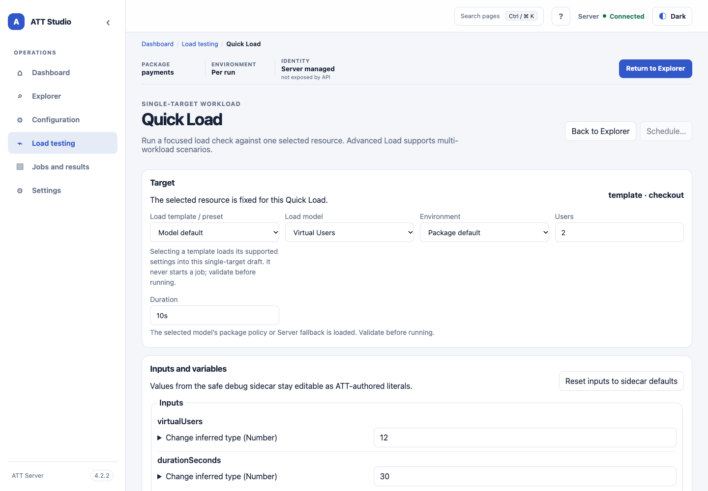
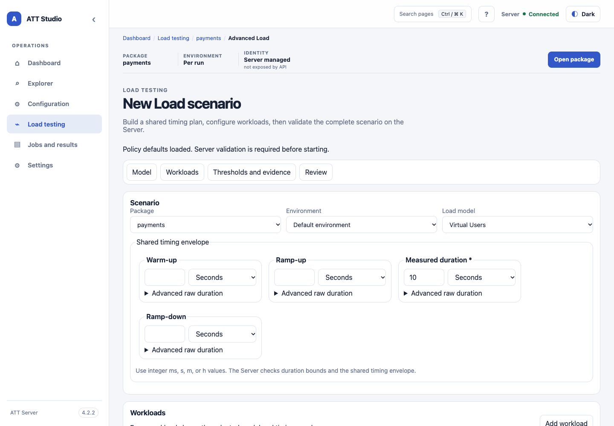

<!-- att-doc-status: current release=4.3.1 -->

# Studio Load testing

*Quick Load 示意表單，使用示例設定。*

*Load builder 靜態 UI shell 基線截圖，使用示例 workload；圖中版本標籤屬於截圖基線。*

瀏覽器建立的 Quick Load 與 Advanced Load 預設停用。Server 管理員必須設定 `server.inlineLoad.enabled: true`，並配置 workload、target、user、rate、並行數及 duration 上限，這些表單才可建立 draft。UI 會從 `/api/v1/version` 讀取 `inlineLoadEnabled`；功能關閉時會停用 Advanced Load 入口、隱藏 Quick Load，直接開啟頁面則會顯示停用狀態。停用時 endpoint 回傳 `403 ATT-SERVER-INLINE-LOAD-DISABLED`；超出上限的 draft 會回傳 `400 ATT-SERVER-INLINE-LOAD-LIMIT`，並以摘要指出超出的設定。此設定不會停用既有 path-based Load 用戶端。

LOAD Catalog 中的可執行情境提供 **驗證** action。Inline result 會透過 `POST /api/v1/validations`，以該 scenario、Package 及 Environment 提交持久 validation record，不會建立 LOAD draft 或 Job。另一個 draft **Validate** action 保持既有行為，供 Run Now 及 Schedule 使用。

Inline draft 及 package-backed scenario 均使用 Server 設定的 LOAD duration 上限（`server.inlineLoad.maxDurationSeconds`，最多 864,000 秒／10 日）。完整 envelope 依 ramp-up、warmup、steady duration 及 ramp-down 順序執行。長時間 run 會以唯讀方式估算保留 evidence 檔案及位元組數，並檢查 evidence quota、Tool output 保留設定、artifact archive 容量及可用輸出磁碟空間；風險會以 warning 顯示，duration 本身不會令工作被拒絕。

Quick Load 是第一層路由，可對單一選定的 Template、Flow 或 Tool 執行。有限制的 template picker 會列出 package `load/` 目錄內相容的 policy-only YAML 檔案，包括相容的 `load/load.visualuser.yaml` 和 `load/load.arrivalrate.yaml`，以及只適用於 Virtual Users 的內建 **Quick smoke** preset。選取 template 會載入其支援設定；未選取相容 package template 時，Server 會提供該 model 的預設值或內建 10 秒低強度 fallback。切換 preset 或 model 會更新未提交的 scenario；Target 維持固定，Debug-local Testdata imports 不會自動提升。Advanced Settings 保留 thresholds、evidence、execution options、Testdata paths 及完整 scenario preview。先驗證單一 target scenario，確認後才提交。Server 會將 draft 綁定至已驗證 Principal 及目前 package revision，並提交與驗證相同的不可變 scenario。Schedule 會將已驗證 draft 帶入 immutable inline Load snapshot，因此無須重新輸入 target、environment、inputs、pacing、thresholds 或 evidence。

首頁每個 package 都可開啟 Advanced Load。先選擇 `virtualUsers` 或 `arrivalRate`，再新增 workloads；所有 workload 都使用同一 model。設定共用時間窗口、選填 seed、package-relative Testdata imports、execution defaults、aggregate thresholds 及 evidence policy。你可以新增、複製、排序或移除 workload。每個 workload 有自己的 intensity、target、Testdata policy 及 thresholds。Workload 可使用單一 Template、Flow 或 Tool target；Virtual Users 亦可使用 weighted target mix。每個 Arrival Rate workload 使用一個 target。Target sidecar 預設值只包含安全的 business 欄位；不會複製 Debug `case`、`stage` 或 local Testdata。驗證完整 scenario 並檢視安全 YAML 後，確認即可由 Server 以不可變 draft 交給一般 Load scheduler。只有預覽未遮蔽時才可複製或匯出。

當 `/api/v1/version` 回傳 `loadSchedulingEnabled: true` 且 caller 具備設定的排程管理 role（預設 `ATT_ADMIN`）時，可在 React 主控台的 `#/schedules` 使用 Schedules。可從已驗證的 Quick/Advanced Load draft 建立排程，亦可沿用 package-relative Load scenario。Draft-based 排程會保留 Server 正規化後的 immutable scenario snapshot；API view 只顯示 `inlineSnapshot`，不會回傳 scenario 內容。Server 會在每次 occurrence 前重新驗證 snapshot 及 package revision。頁面支援 descriptions、tags、IANA timezone 的 next-run preview，以及 daily、weekly 或五欄位 cron。Preview 只計算執行時間；儲存時會透過 inspection Worker 驗證完整 scenario 及 target closure。切換 recurrence 會取代已儲存的 trigger；只修改 metadata 時則保留該 trigger 及其經 Server 確認的 next run，因此已執行過的一次性排程仍可重新命名或修改說明。儲存驗證失敗時會顯示診斷碼，以及可用的摘要、欄位、source 位置、package、environment、target 和建議，並附 request ID。使用 **Review field** 可前往相關控制項或開啟已保存的 snapshot。本機絕對路徑會遮蔽。新排程預設暫停，只有選取 **Enable after saving** 才會啟用。Run Now 和刪除都需要確認。Occurrence history 會說明略過及提交失敗，並將已提交工作連結至一般 job 頁面、結果、事件與 artifacts。排程和歷史在 Server 重啟後仍保留；編輯或刪除排程不會取消已接納工作。

在 Quick 或 Advanced Load 按 **Schedule…** 會於目前編輯器上開啟排程表單，並顯示安全的驗證預覽。取消後會返回同一個 draft。若 inline snapshot 含有 credentials 或其他已分類敏感值，Server 會在儲存排程前拒絕；請將這些值保留在 package-managed configuration。

共用 React shell 會跟隨作業系統的淺色或深色偏好，直到你自行選擇主題；選擇會保存在瀏覽器儲存空間。按 `/` 或 `Ctrl K`/`⌘ K` 搜尋頁面，按 `?` 開啟快捷鍵清單，按 `Esc` 關閉對話框或手機導覽。在 Advanced Load 頁面，按 `Ctrl Enter`/`⌘ Enter` 只會啟動仍有效且已驗證的 draft，並保留既有確認步驟。主控台和 Schedules 編輯器會適應平板及手機寬度，保留清晰的鍵盤焦點，尊重減少動態效果設定，並以文字標籤配合狀態顏色。

第一層 Configuration 工作區位於 `#/configuration`，在 **All packages** 下也可直接使用。Source、Declared、Effective 和 Compare 透過全域已驗證 API 檢視共用 Runtime config；Environment 只切換 effective values，不切換來源樹，也不會回退至任何 Package。只有 Testdata 顯示獨立的 Package selector，並在該 Package 內解析 records。舊有 `#/configuration/{packageId}` deep link 保留，但共用檢視忽略其 Package context。檔案遍歷、source-reference 授權、source policy、遮蔽及 admin-field 限制保持不變；無效或不可用設定顯示明確狀態。

Declared 和 Engine effective 檢視使用共用 Runtime 的 `FrameworkConfigLoader` 選擇規則，不會連接 DB、MQ、HTTP 或 SSH。可直接檢視 Runtime 預設值，無需選擇 profile。Compare 預設顯示 environment-specific 值，並在分頁前套用所選 section；**Include inherited/global fields** 可選擇顯示 shared values 及 provenance。Configuration admin 可選擇 **Show additional DB configuration fields** 檢視其他非秘密 DB properties 及 evidence fields。Container-auth deployment 使用 `server.inspection.configurationAdminRole`（預設 `ATT_ADMIN`）；local-auth deployment 需要本地 `ADMIN`。Credentials 及設定的敏感值仍會隱藏。Hidden 和 missing 狀態會保持區分；UI 不會比較 hidden 值。Tool 詳細資料會連結至其設定 section。公開 endpoint 及分頁參數見 [ATT Server 安全與身份](../../operations/security.zh.md)。

Source 和 preview 共用 lazy-loaded CodeMirror 編輯器，支援 YAML、JSON、XML、SQL、Shell 及純文字。它會標示 ATT 的 `${...}`、`#{...}`、`@{...}` 和 `&{...}` expression。只有帶有 Server 簽發不透明 token 的檔案參照才會連結回 Configuration。Server 將 token 綁定 package、origin 及 target，並在回傳文字前重新驗證參照；UI 不會根據客戶端解析的路徑建立連結。編輯器工具列支援複製、搜尋、跳至行號、全螢幕及安全格式化，不會執行程式碼。Debug sidecar 的 scalar 欄位仍以表單為主，巢狀值可用 Advanced JSON 編輯。Threshold 和 Evidence 提供表單及 Advanced JSON；無效 JSON 會保留在草稿中，不會取代最後有效設定。

開啟 **Schedules** 時，首先顯示已儲存的 RUN／LOAD 定義清單，不會顯示新增或編輯表單。可搜尋名稱、target、package、environment、owner 或 cron，並按執行類型、狀態、package 及 API 提供的 owner 篩選。清單顯示類型、target、package／environment、時區、recurrence、next run 及狀態；只有 API 授權回傳的 owner／近期狀態才會顯示。

選取 **New Schedule**（`#/schedules/new`）或 **Edit**（`#/schedules/<id>/edit`）開啟獨立表單。RUN 必須先在 **Run** 驗證 Case、Template、Flow、Tool 或 typed batch selection，再從 Review 選擇 **Schedule…**。已驗證的 Quick／Advanced／YAML LOAD 使用相同排程 drawer，保留背景來源編輯器及 Server draft ID，因此不會重建或改寫 typed inputs、Case 選取、Debug mode 或 LOAD policies。儲存只建立定義，不會立即執行；新排程預設暫停，啟用前請檢查 next-occurrences preview。LOAD 亦可使用現有 package-relative scenario path。

**Cancel** 及 **Back to Schedules** 會保護未儲存變更；重新整理或關閉分頁時會提示，切換分頁則保留記憶體內表單。Draft 與憑證不會寫入 browser storage。重新整理無法還原尚未儲存的已驗證 draft，必須返回來源重新驗證。Edit／History deep link 會重新讀取 Server 定義，舊 `#/load-schedules` 及 `#/scheduled-load` 連結仍可使用。

**History** 使用 `#/schedules/<id>/history`，occurrence 連結使用 `#/schedules/<id>/history/<occurrenceId>`，範圍為最近 100 筆保留紀錄。超出範圍或已移除的紀錄會顯示不可用狀態。只有 Server 提供可用 job status 時才顯示 Job 連結，Job／Report 授權仍由 API 檢查。**Run Now**、**Pause/Resume** 及 **Delete** 均須確認；手動觸發 LOAD 仍建立 LOAD Job。舊 Scheduled Debug 顯示為 RUN 加 Debug mode，透過 adapter 保留後端識別。Misfire、retention、capacity、revision 及 DST 政策仍由既有統一 Scheduler 管理。

Advanced Load route 使用有型別的控制項設定 duration 單位、Virtual Users、Arrival Rate、最大並行數及 think time。Target sidecar 預設值會為 `inputs`、`vars` 及 Tool `arguments` 提供有型別 scalar 控制項；巢狀值保留在 Advanced JSON。表單會按 model 顯示適用限制，但驗證、policy 上限、draft 過期、package revision 及執行仍以 Server 為準。確認後，UI 會提交同一份由 Server 簽發的 draft；回應已遮蔽時不會提供預覽複製或匯出。

Jobs 在 Server 對完整 matching history 執行 filter、Target 排序／分組及真正分頁。Target 連結開啟指定 Job Details；每列保留 Package/Environment、可複製的縮短 Job ID、Schedule principal、Created/Started/Finished/elapsed。Recent Jobs 預設最新優先。Rows per page 支援 25/50/100（初次預設 100，保存在瀏覽器）。Pin/Delete 圖示立即生效。兩個 footer 選單對當頁所有 Job（包括收合群組）設定 pin/unpin 或 mark/unmark；逐 ID 結果解釋部分失敗。Deletion mark 在至少 30 秒後的背景 claim 前可取消；pinned、active、busy、quarantined Job 仍受保護。Job Details 保留 Overview、Live Output、Events、Results、Artifacts、Metrics；取消執行仍需確認。

Explorer 是 React 與 TypeScript 單頁 UI，於 `att-web` Maven resource 階段使用 Vite 建置。Maven 會把產生的靜態資源複製至 `META-INF/resources/ui/`；Server WAR 再將它們封裝供 Tomcat 提供。Node.js 只用於建置階段。部署後的 UI 呼叫同源公開 REST API，無需額外 Node 程序或前端服務。

## SUT Metrics 及離線 LOAD 報告

Global Runtime Config `att-config/v2.15` 透過 `sutMetrics.dataSources` 引用 `config/sut-metrics/` 下的 SUT Metrics Data Source 描述檔；Environment profile 可以整份取代描述檔清單。Data Source 可直接使用 Prometheus，或使用固定一個 `grafanaDatasourceUid` 的 Grafana proxy；Grafana 請求只會使用固定 `/api/ds/query` route 及 Server 管理的 PromQL。請以 `ATT_SECRET_*` reference 配置 server-side service account token、已驗證 TLS、核准 host、permitted organization list 內明確的數值型 default organization ID，以及有界 request／sample 上限。Settings 顯示全域 connection 資訊和存取政策。Studio 不接受瀏覽器 URL、datasource UID、PromQL、token 或 proxy override。

LOAD Job 結束後，既有的有界 SUT Metrics collection 在完成驗證且有最終狀態時，會另行發佈版本化離線報告。已驗證報告的下載與 `artifacts.zip` 分開，不會重寫原生 archive 或其 manifest。報告包含 source-neutral observation metadata、有界圖表預覽、已驗證 series sidecar、coverage、gaps、execution status 及 LOAD phase windows。Business observation 亦會保留 Workload/mix identity、呼叫次數、mapping quality、未匹配 row 數，以及可用時的數值；raw result rows 不會發佈。Partial 或 unavailable collection state 會如實顯示。報告是靜態檔案，可離線使用，也不會發送即時請求。它不會評估 performance threshold，亦不會改變 Job result。若未來 verdict writer 提供獨立版本化 verdict record，報告可顯示該資料。此流程不會增加 continuous collector，專用的 **SUT Metrics** 與原生 **Metrics** tabs 仍保持獨立。

## 儲存私人 Scenario

驗證 Load Template 組合後，選擇 **Save Scenario** 並輸入名稱。儲存會在 Server 建立私人記錄，不會啟動 Job、建立 Schedule 或寫入 Package 檔案。在 **Load testing → Scenarios** 的 **Saved scenarios** 中，可以搜尋、重新開啟、複製、驗證或刪除自己的記錄。Template 組合會在 Load Template 編輯器重新開啟；API 撰寫的 scenario 定義則在 Advanced Load 編輯器開啟。編輯並儲存會建立新版本，在同一個編輯器再次儲存亦然；版本衝突時須重新載入。儲存後須返回清單並驗證已儲存的版本，才可執行或排程。只有經驗證的預覽明確標示為未遮蔽時，檢視對話框才提供 **Export YAML**。

驗證結果有時效。選擇 **Run** 或 **Schedule** 前，須再次驗證已儲存的版本。Schedule 會儲存獨立的已驗證快照；其後編輯或刪除已儲存的記錄不會改變該 Schedule。若定義包含受保護的輸入值或解析後的值，系統會拒絕儲存；請移除該值或使用核准的參照。

## SUT Metrics

Global Runtime Config `att-config/v2.15` 管理共用 Data Source 描述檔和存取政策。`sutMetrics.dataSources` 項目指向 `config/sut-metrics/` 下的版本化 YAML 檔；Environment profile 可以整份取代清單。既有 Runtime Config 保持相容；遷移至 Package 所有制時請使用 v2.15 描述檔格式。Settings 顯示目前全域 Data Source connection、reader policy、tenant 範圍和 limits；不在此建立 Package 的 Metric Sources、Groups 或 Profiles。

使用 `att-package/v2` 的 Package 會在 `package.yaml` 的 `observability.metricSources`、`observability.groups` 和 `observability.profiles` 明確列出自己的 SUT Metrics 定義。每個路徑都指向 `load/sut-metrics/{sources,groups,profiles}/` 相符目錄內的一個版本化 YAML 定義。Package Metric Source 可引用全域 Data Source 邏輯 ID、所選 Environment 中既有的全域 DBHelper，或同一 Package 所有的 Package Tool；不允許跨 Package Tool。Package 檔案在不同 Environment 使用相同 Data Source 邏輯 ID，不會固定環境專屬 connection revision。v2 flat Profile 選擇 Metric Sources 和 Groups，並限制 Environment、target、tenant、parameter 和 collection budget。v2 inventory 不存在或為空，代表沒有 SUT Metrics；不會退回使用全域 metric 定義或其他 Package。ATT 不會掃描目錄尋找定義。

<!-- att-docs:historical -->
舊版 `att-package/v1` Package 保留歷史全域 v1 Metric Source、Group 及 base/composite Profile 行為。這些 Profile 可包含 typed parameters 及 source/target binding；仍不支援巢狀 composite 和 `extends`。
<!-- /att-docs:historical -->

v2 Package 的 LOAD 只會選取所選 Package 明確列出的 Profile。Profile 提供允許的 sources 和 targets；Scenario 不會選擇全域 Profile 或 connection。

LOAD Profile picker 只會為新 binding 提供 Package 自有的 v2 Profile。舊 v1 Package 已手動撰寫的 binding 仍可相容，其安全 Profile metadata 仍可用於 threshold 編輯。建立新 binding 前，請先把定義明確遷移至 Package 的 v2 inventory。

Explorer 的 Package catalog 只列出明確納入 inventory 的定義，並顯示 Package、Runtime Config、manifest 及資源來源資訊。Package owner 可開啟已列出的 YAML 資源，透過 **Validate**、**Review** 和 **Publish** 草擬及發布修改。此編輯器處理既有 inventory 路徑；manifest 仍是登錄定義的依據。Catalog inspection 和 definition validation 會檢查 schema、references、reader permissions 和 limits，但不會執行 SQL、DBHelper query 或 Package Tool。Settings 的 Data Source **Test** 是另一項明確的獨立操作。

v2 Metric Source 定義一次有界 fetch、輸出 metrics、label mapping 及 limits。Prometheus 使用 `mapping.labels.retain` 選擇 output routing 後保留的 labels；`metricName` 和 discriminator 會先用於 output routing，因此不必保留 `__name__`。SQL 類 source 使用 `mapping.labels` 將每個公開 label 對應至明確結果欄位；只有映射欄位會成為 labels。Label 名稱有界，並拒絕保留或敏感名稱。不同 Prometheus series 投影成相同 retained labels 時會產生 diagnostic。SQL 類 source 可用一次查詢將 wide-row 結果映射成多個具名 output。Dynamic metric-name pivot、Long Rows、未知 labels 和 executable transforms 不支援。Flat Profile 的 `budgets` 可限制 `maxFetches`（1–256 次 logical fetch）、`maxObservations`（1–4,096 個 normalized observations）及 `maxArtifactBytes`（1 KiB–64 MiB）；所選 limits 會固定於 Job snapshot，並在解析和 collection 階段執行。超出限制時會回報錯誤，不會寫入超出預算的 observation 或 artifact。Group rules 精確比對 source ID、metric ID 和 label value；同一 Profile 內重疊的規則會被拒絕。Group matching 和 `groupBy` 只影響呈現，不會改變 observation identity，也不會觸發額外 fetch。

新 Job 會在不可變 v2 snapshot 固定 Profile 和 source revisions、redacted Fetch Plan、output mappings、expected subjects、Group rules 及 collection budgets。v2 Package snapshot 亦會保留所選 Package manifest/resource digests，以及 Runtime Config revision 和 Environment。Executable query/call payload 另存於 Server 私有、以 digest 綁定的檔案。歷史 v1 snapshots 會透過 deterministic adapter 繼續讀取；歷史 snapshots 和封存的 LOAD artifacts 不會改寫。遇到不支援的舊格式會明確失敗。Schema 層級的 v2 contract examples 位於 [`examples/load/sut-metrics/v2`](../../../examples/load/sut-metrics/v2/metric-source-db-wide-row.json)；完整的 4.3.1 Package 所有制結構請參閱 [Package-local SUT Metrics 範例](../../../examples/package-local-sut-metrics/README.md)及[遷移指南](../../guides/sut-metrics-config-migration.zh.md)。

HTTPS Data Source host 必須與 Server 的 `ATT_SUT_METRICS_ALLOWED_HOSTS` 環境變數其中一項完全相同。設定值以逗號分隔，只接受完整 host name 或 IP address，不接受 wildcard 或 URL path。HTTP 只適用於本機開發時的 loopback Prometheus。Server 不跟隨 redirect，也不使用 proxy。請同時用部署網路 egress rules 限制 DNS 解析後的 destination IP。

`att-load/v1.9` 可選擇在 root-level 加入 `observability`，將 Profile 綁定至 LOAD scenario。在 Advanced Load 使用 **Package SUT Metrics Profile**，即可加入所選 Package 中符合 Environment 條件的 Profile。Scenario 只選用該 Profile ID；sources 和允許的 targets 來自 Package 定義。以下範例選用 Package-local 範例的 `basic` Profile。舊版 v1 Package 仍使用全域 base/composite Profile binding 規則。Scenario 不接受 Prometheus URL、credentials 或任意 PromQL。

~~~yaml
observability:
  schemaVersion: att-load-observability/v1
  collections:
    - profile: basic
  collection: { mode: post-run, before: 5m, after: 2m, step: 30s }
  livePreview: { enabled: true, refreshInterval: 30s, defaultRange: 15m }
  thresholds:
    - id: cpu-steady-90
      profile: basic
      metric: cpu-utilization
      max: 90
      unit: percent
      minimumCoverage: 0.95
~~~

Rule 的 metric ID 和 unit 必須存在所選 Profile 的 declared outputs；Profile 可以來自 v2 Package inventory 或舊版 v1 全域 catalog。Prometheus 規則使用實際 UTC `STEADY` phase，並對每個 source target 分別評估 sampled maximum，不會將 target 數值平均。最大值等於 90 時為 `MET`；任何有效 sample 高於 90，即使其他 sample 缺失，仍為 `NOT_MET`。缺少、過舊、partial 或 coverage 不足的資料會是 `NOT_EVALUATED`，除非已有有效 sample 證明超標。Prometheus 規則支援 `targets: all`，預設最低 coverage 為 95%。Business rule 會對每個 Job、Workload 或 mix subject 評估一個 numeric output，不使用 `minimumCoverage`。省略 `subjects` 或設定 `subjects: all` 會選擇所有 subject。若要明確選取 subject，請使用 `scope: job`、`scope: workload` 加 `workloadId`，或 `scope: mix` 加 `workloadId` 和 `mixId`。每個 selector 必須解析至一個不可變 identity。Business rule 亦支援 numeric `counter` output。兩種 rule 都只支援 `max` 和 `<=`。

Server 會將正規化規則、metric binding、revision 和 target 固定在每個 Job snapshot。Collection 完成後，有界的非同步 evaluator 會寫入 `jobs/<JOB_ID>/sut-metrics/threshold-evaluation.json`；Server 重啟後會恢復中斷或可重試的 evaluation。此版本化記錄獨立於 Worker result，不會修改 execution status 或 native LOAD threshold summary。已授權的 `GET /api/v1/jobs/{id}/result` 會加入 `performanceAcceptance`，回報 `executionStatus`、`nativeLoadThresholds`、`sutThresholds`、`externalEvaluationStatus` 及 combined `performanceVerdict`。Results 與 SUT Metrics 會顯示每個 target 的 peak、limit、sample count、coverage 及原因。Post-run evidence 尚未就緒時，external state 和 combined verdict 會保持 pending。

LOAD Job Details 的 **SUT Metrics** 分頁會顯示 source、target、profile、coverage、sample freshness，以及每個 series 的 min/mean/max。Metric Group filter 使用固定在 Job snapshot 的 Groups，並顯示已分組 instance 的精確 `groupBy` labels。Unassigned 或 ambiguous observations 仍可識別。Group filter 只導覽既有 observations，不會觸發 source query。Business metric card 會區分 Job-wide 與明確 Workload/mix value，並顯示 call source type/name、call group 和執行次數、有資料時的精確 UTC collection time 和 query window、mapping status、未匹配 row 數及安全 diagnostics。LOAD 執行期間，分頁每 30 秒向 Server 取得受限、只讀、以 snapshot 為準的 preview。可以選擇 target、source、metric、profile 及 5 分鐘至 4 小時的 range。切換至其他 Job 分頁或瀏覽器文件隱藏時，系統會停止 polling。LOAD 完成後，分頁會讀取獨立 `jobs/<JOB_ID>/sut-metrics/` 目錄內有 checksum 的 sidecar，不會修改已封存的 LOAD report 或 artifact archive。Post-run collection 使用實際 LOAD execution 和 phase 時間，列出 RAMP_UP/WARMUP/STEADY/RAMP_DOWN/DRAIN 邊界，並加上設定的 before／after 範圍。Mixed Job 的 after-drain business call 會在 LOAD 完成後立即開始；已驗證的 value 會以 provisional、唯讀證據顯示，而 combined manifest 仍為 `PENDING`，並標示 `business: COMPLETE`、`prometheus: PENDING` 和 Prometheus `eligibleAt` 時間。Threshold evaluation 及 combined performance verdict 會等到 collection 終結後才完成；此 buffer 期間的 polling 會依 deadline 逐步退避。Server 重啟後，已完成的 Business phase 會保留並只恢復尚未完成的 Prometheus phase；若重啟時 Business call 仍在執行，系統會以 `SERVER_RESTART_INTERRUPTED` fail closed，不會重試 side effect 未知的 call。Prometheus query 會等到 after window 加上一個 query step 後才執行。若查詢有樣本，只有最新可用 sample 在 LOAD 完成後，且距 window end 不超過既有 `max(2 × step, 30 秒)` freshness tolerance 時才會標示 READY；缺少 post-finish 樣本或尾端覆蓋過舊則標示 PARTIAL。After-drain business value 有獨立固定兩分鐘 freshness 上限，不受 Prometheus after buffer 影響。若執行前 pinned Package 或 Runtime Config revision 已改變，ATT 會 fail closed；sidecar 記為 `NOT_EVALUATED`，Job diagnostics 會回報 `BUSINESS_CALL_PACKAGE_CHANGED` 或 `BUSINESS_CALL_CONFIG_CHANGED`。系統不會保留原始 executable revision 供延遲執行，也不會靜默使用已改動的檔案。請在準備好預期的 Package 和 Runtime Config 後提交新的 LOAD Job。成功但沒有資料的結果維持 NO_DATA。長時間範圍會拆成最多六小時的請求，總 collection window 上限為 26 小時。

Post-run sidecar 使用版本化、provider-neutral 的 `att-sut-metrics-observation/v1` contract，記錄 effective binding、安全的 source/profile/target revision hash、metric unit/kind、UTC execution/query window、step、phase window、freshness、sample coverage/gaps、availability 及已遮蔽的 provenance。Multi-output business call 會為每個已宣告 output 和預期 subject 寫入一個 numeric observation；raw result rows 只保留在記憶體。Mutable collection manifest 會綁定 Job 和 immutable snapshot，並在同一個 atomically published file 內嵌有上限的 integrity history。Server 重啟時會讀取完整的 manifest 狀態，並明確恢復中斷的 `COLLECTING` 工作。空結果維持 `NO_DATA`，不會補成零。

Collection 狀態包括 `PENDING`、`COLLECTING`、`READY`、`PARTIAL`、`UNAVAILABLE` 及 `FAILED`；live metric 另會顯示 `STALE`、`NO_DATA` 或 unavailable。Collection 狀態本身不會改變 Worker result 或 native verdict。已配置的 SUT rule 會在 evaluation 後透過獨立的 combined performance acceptance 生效，不會把 SUT 數值疊加至 TPS／latency。

## 對照 LOAD 與 SUT metrics

LOAD 到達 terminal 狀態且授權的 artifact archive 已就緒後，**Correlation** 會讀取已封存的原生 LOAD window series 及所選的 post-run SUT query。較長的 LOAD series 會透過授權 detail sidecar 讀取。此檢視不會以 Job 建立時間作為觀測起點、不會把 series 加入 Worker result 或 Job metadata，也不會更改現有的 **Metrics** 和 **SUT Metrics** 分頁。缺少原生 phase series 的舊報告會顯示不可用狀態。

先選擇 aggregate LOAD 或單一 workload，再選擇 LOAD metric、phase 及時間範圍。預設範圍包括全部資料，或以最新觀測時間為終點的 15 分鐘、1 小時、6 小時及 24 小時。選擇 **Custom UTC range**，再輸入 `YYYY-MM-DDTHH:mm:ssZ` 格式的 UTC 開始及結束時間；秒後可選擇加入 1 至 3 位毫秒數字。LOAD 選項會分開顯示 completed TPS、successful TPS、scheduled／started rate、SUT failure 數量、runtime error、generator drop，以及 scheduled-cohort latency p95。SUT 資料可按 profile、pinned Metric Group、target、metric、source query 及具標籤的 instance 篩選。選取 Metric Group 會依固定的 Group assignment 和 `groupBy` labels 篩選既有 observations；此選取不代表因果關係，也不會改變 Metrics 分頁或 LOAD result。所選 series 會以共用 UTC 時間軸及各自標示單位的左右 y 軸顯示。LOAD 點使用實際 bin 起始時間及 duration；SUT 點使用記錄的 sample timestamp。Phase 色帶及篩選使用已封存的 UTC phase 邊界。

每個 series 都保留其回報的解析度。畫面會顯示觀測到的最小值及最大值。LOAD 平均值使用觀測點的算術平均值，但 latency p95 除外。SUT 只會對宣告為 gauge 或 rate 的 metric 計算觀測 sample 算術平均值；此值不是按時間加權的估算。Counter 及 histogram 不會計算平均值。平均值會排除缺少的時間間隔；系統不會以零補值或插值。LOAD coverage、native capacity 及實際 bin timestamp 會與舊 Metrics ring 分開顯示。該 ring 保留 4,096 個一秒 bucket，不會用來推斷 native window series 的解析度。LOAD rate 仍使用完整 native bin 作為分母，即使 bin 只與所選 phase 部分重疊；畫面會指出這些 partial bin。Latency p95 仍是 scheduled-cohort percentile：畫面會顯示其觀測範圍及 cohort sample 數量，不會跨 bin 或 workload 平均 p95。圖表每個 series 最多顯示 1,200 個 downsampled 點，並會列出顯示點數及篩選後點數；downsample 前遇到實際缺口時會中斷線段。

Provenance 欄位會分開標示 LOAD target 和所選 workload，以及 SUT source、target、profile、metric、unit、collection window、effective step、可用 instance 數量、所選 sample 數量、sample coverage、最新所選 sample 時間及其相對於 requested collection-window end 的差距。Manifest 更新時間會與 sample 時間分開標示。選取 workload 不代表共享主機 CPU、JVM、database 或 MQ 數值屬於該 workload。圖表只供時間上的對照；時間重疊不代表因果關係、判定或根因。

可部署的 4.3.1 Package-local 結構位於 [Package-local SUT Metrics 範例](../../../examples/package-local-sut-metrics/README.md)；現有定義的移轉方式請參閱[遷移指南](../../guides/sut-metrics-config-migration.zh.md)。較舊的 [`examples/load/sut-metrics/`](../../../examples/load/sut-metrics/) 檔案展示全域 v1 定義及 binding 格式。
