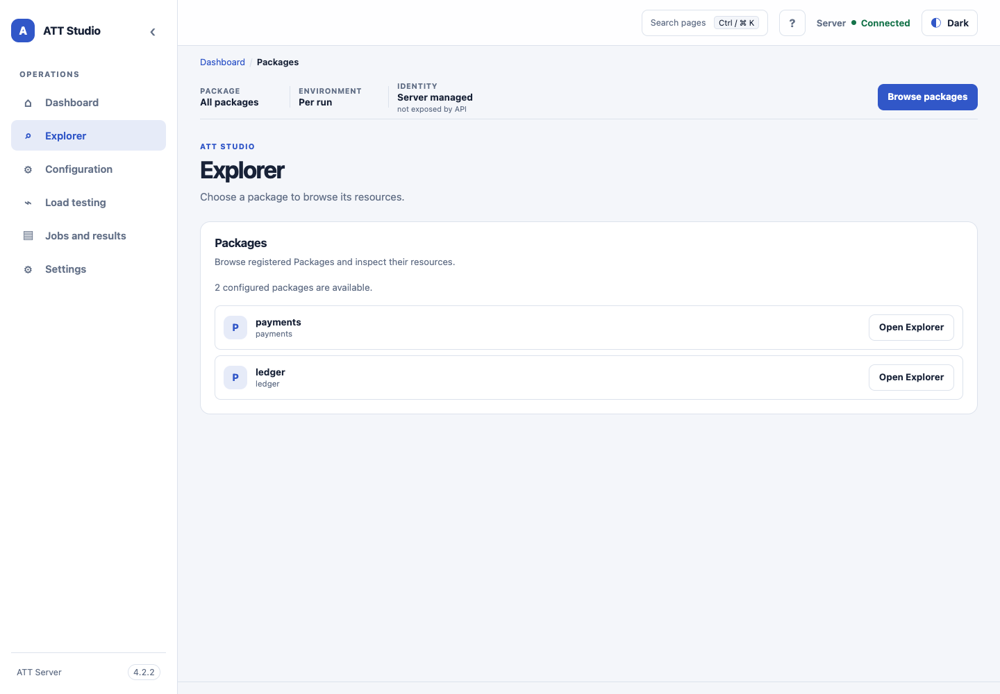

<!-- att-doc-status: current release=4.2.5 -->

# Studio navigation

ATT Server bundles a static browser console at `<Tomcat context path>/ui/`, for example `https://host.example.com/tools/att/ui/`. Use a maintained Chrome, Edge, or Firefox release. With `server.auth.mode: container`, Tomcat protects `/ui/*` and `/api/v1/*`; HTTP Basic credentials are handled by the browser and are not stored by ATT. With `server.auth.mode: local`, ATT provides its login page and local account workflows. For authenticated deployments, use HTTPS.

*Illustrative UI capture with sample Package and Job data.*

*Illustrative Package selection view with sample data.*

*These are static UI-shell baseline captures; the displayed version badge belongs to the screenshot baseline.*

The console lists configured logical package IDs and recent persisted jobs. Select a package to submit Run, Debug, Load, or Validate requests, then open a job to follow progress, inspect terminal results and safe diagnostics, cancel an active job, or download logical artifacts. Inputs for package resources are logical paths relative to the selected package. The UI never accepts or displays `PACKAGE_ROOT` or Server storage paths. The Artifacts tab shows archive status, reports and bounded text previews from the verified ZIP. **Download Artifacts (.zip)** is the only download action; HTML reports open in an isolated viewer. See [artifact publication and recovery](../../reference/results-reports-evidence.md#att-server-job-artifact-publication). Direct job links such as `/ui/jobs/J10045` redirect to the canonical hash route, which reloads the job from the public API and SSE.

The browser uses only the public same-origin `/api/v1` REST and SSE contract. REST requests and native `EventSource` use the browser's container-managed authentication. SSE reconnects use the browser's standard `Last-Event-ID` behavior; refreshing a job view reloads job state and retained events from the Server. Closing the browser tab does not cancel the job. Cancellation requires confirmation and the UI waits for the Server's terminal status.

The UI checks the Server API version before loading job data. Terminal SSE results close the browser event stream rather than reconnecting to completed jobs; live progress is shown separately from bounded event history. The authenticated static UI and API share one Tomcat security boundary.

The console is delivered as static `att-web` JAR resources under `META-INF/resources/ui/` and packaged in the Server WAR. Relative URLs support non-root Tomcat context paths without a separate frontend service or runtime Node.js dependency. The Server applies a same-origin content security policy and rejects state-changing browser requests with an unexpected `Origin`; no credentialed CORS policy is needed. Browser-rendered API text is inserted as text, and the event list is bounded to 500 entries.

For fields without a public discovery schema, the UI uses safe sidecar data for typed scalar controls and provides Advanced JSON for nested values. Server validation remains authoritative; browser-side validation and filtering are not authorization boundaries.
