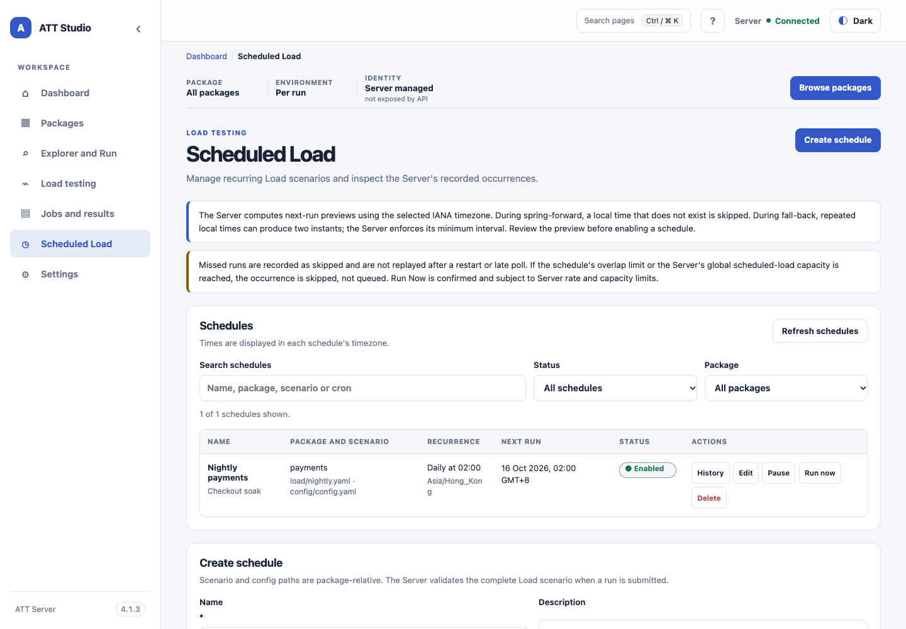

<!-- att-doc-status: current release=4.2.8 -->

# Schedules in Studio

*Static UI-shell baseline capture with sample schedule data; the version badge belongs to the screenshot baseline.*

## Schedule routes and standalone console (4.2.4)

Schedules lists never display Schedule IDs. LOAD summaries show saved configured VUs or arrival rate, planned total duration and available warmup/ramp/steady phases per workload, with bounded target bindings. Missing historical settings show Not available. The list reads persisted sanitized summaries without per-row YAML requests.
History → Back to list → Edit resolves both the route view and schedule ID. Refreshing the authorized list preserves unsaved edits in the same form; missing or forbidden definitions show an unavailable state. Legacy RUN definitions without an editable validated snapshot explain how to review a replacement RUN.

From a Job, **Schedule / Reschedule…** opens a new Schedule draft; **View / Edit originating schedule** is a separate action. **Run now** remains independent of both. Schedule `strict`/`pause`/`ignore` policy applies to scheduled submissions only; manual Job Rerun has its own current-versus-strict source choice.

**Open full Job Details in a new tab** opens `#/jobs/{encodedJobId}?standalone=1&tab=live` (or `events`) with Overview, Live Output, Events, Results, Artifacts and Metrics. Tab switching updates the URL while keeping the Job fixed. Old `#/jobs/{jobId}/console?view=live|events` bookmarks adapt to the full Details workspace. Same-origin `target="_blank" rel="noopener noreferrer"` links support `/att/ui/`, refresh and browser navigation. One Job stream is shared within each tab; floating/docked/minimized consoles keep their existing behavior. Inaccessible Jobs show safe unavailable or sign-in messages.

## Review an execution change

Open an existing Schedule and select **Edit execution settings**. Save or discard pending Schedule Settings changes first. For an inline LOAD snapshot, the current editor supports workload users or arrival rate and concurrency, individual or common phase overrides, and single-workload targets. Mix bindings and advanced settings require a different workflow. For a RUN snapshot, it supports case IDs or a resource target. Changing a resource target clears its previous input bindings. Package-backed LOAD schedules retain their package scenario path and Load overrides. Package-catalog snapshots use the same supported LOAD controls and remain frozen snapshots after review.

Select **Validate changes** to compare the safe before-and-after previews, package revision, policy, and next occurrence. Select **Save as new snapshot** only after review. The Schedule ID, trigger, next run, and earlier Jobs remain unchanged. A stale review or a concurrent Schedule edit must be validated again. An authorized operator can edit a shared Schedule; their review shows the safe Schedule summary and keeps the original execution identity.
